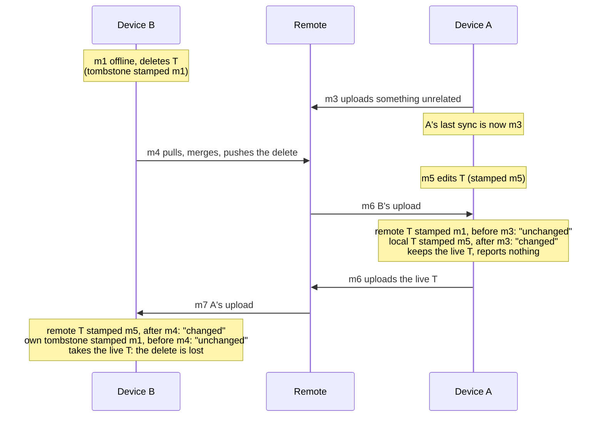
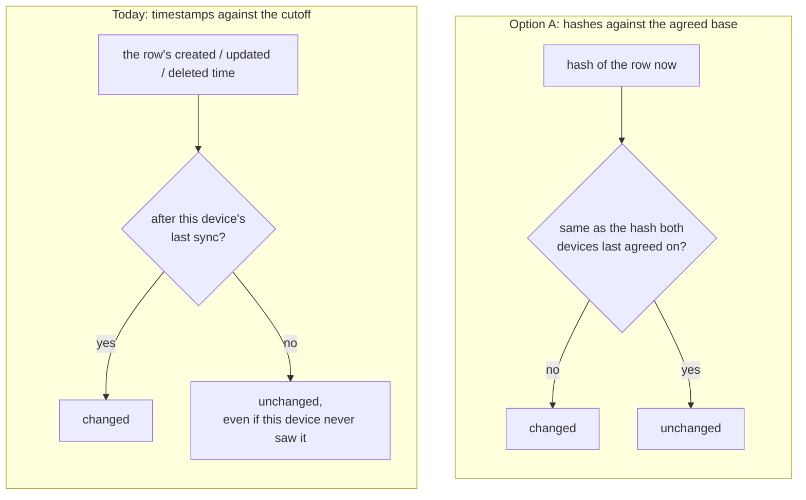
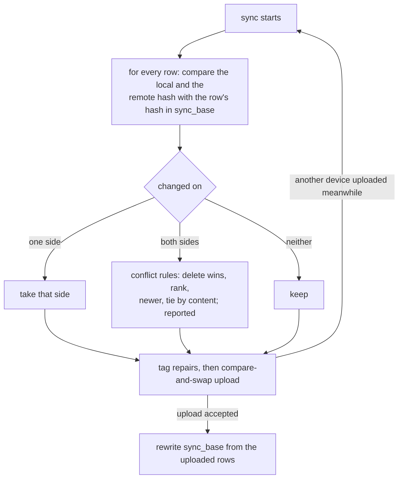

# Sync: Telling Which Side Changed a Row

**Status:** Built 2026-10-27 (option A). Sections 1 to 4 are the record of the decision;
section 5 says what was built. It was a known bug, pinned by two `it.fails` tests in
`src/sync/__tests__/cornerCases/cutoff.spec.ts`, which are plain `it` tests now. Found by the
sync corner-case tests of the tags-and-categories plan (Task A6).

---

## 1. The problem

During a merge, a device decides for every row whether it changed locally, remotely, or on
both sides. Today it decides by comparing the row's own edit timestamps with the time of
this device's last sync. A change made offline and uploaded later slips through.

| Minute | What happens |
|---|---|
| 1 | B, offline, deletes transaction T. The tombstone says `deleted_at_utc` = minute 1. |
| 3 | A syncs (uploads something unrelated). A's last sync is now minute 3. |
| 4 | B comes online: pulls A's upload, merges, pushes the delete. Correct so far. |
| 5 | A (not synced since minute 3) edits T. |
| 6 | A syncs and merges B's upload. Remote T was deleted at minute 1, before A's last sync, so it counts as **unchanged**; local T was edited at minute 5, so it counts as **changed**. "Only the local side moved" → A keeps its live T and uploads it. Delete-wins never runs; no conflict is reported. |
| 7 | B syncs (last sync minute 4). Remote T (edited at 5) counts as changed, its own tombstone (1) as unchanged → B takes the live T. **The delete is lost on both devices, silently.** |

The same path loses a manual exchange rate: B types a manual EUR/USD rate offline, A's
resolver later upgrades its own row of that day to an ECB rate; the override — which
`ROW_RANK` promises is never lost to a resolver — disappears on both devices.

It happens with perfectly synchronised clocks; it is not the "clock skew" item.

What the scenarios doc (`docs/scenarios/2026-05-22-database-sync-scenarios.md`) expects:
both sides changed T since they last agreed, so it is a conflict — the delete wins, and the
discarded edit is reported.

## 2. How sync decides today

1. **Whole-database hash** (`hashDatabase`: canonical JSON of every row, SHA-256) plus
   metadata `{ device, uploadedAtUtc, hash, migrationVersion }` decide whether to sync at all:
   equal hashes → nothing; this device uploaded last → upload; otherwise → merge.
2. **Merge cutoff** (`syncOrchestrator.ts`): `cutoff = lastKnown.uploadedAtUtc` — the upload
   time of this device's last successful sync.
3. **Per row** (`rows.ts` `changedSince`): changed ⇔ `created_at_utc`, `updated_at_utc` or
   `deleted_at_utc` > cutoff. Changed on one side → take it; on both → `resolveConflict`
   (delete wins → rank → newer timestamp → tie by content).
4. **Compare-and-swap upload**: re-merge if another device uploaded meanwhile.

## 3. Why these mechanisms do not catch it

- **The cutoff mixes two clocks.** A row's timestamp says when it was *edited*; the cutoff
  says when this device *last saw the remote*. An edit made offline reaches the remote
  later than it was made, so it can predate another device's cutoff although that device
  has never seen it. The scenarios doc's argument "one device's clock compared with itself"
  is true for scenario 2.1 (this device uploaded last), not for 2.2 (merging a foreign upload).
- **The database hash is all-or-nothing.** It says the two databases differ, not which rows
  differ, and not which side moved.
- **Compare-and-swap** protects the upload from clobbering a foreign upload; it says nothing
  about which side changed a row.
- **Git history is not used.** The GitHub backend pins the HEAD commit it read (for
  compare-and-swap and unchanged-file detection) but never reads the commit this device
  last synced against. The Supabase / S3 backends keep no history at all.

How a row counts as changed, today and under option A below:

Consequences beyond the two tests: every "both sides changed" case where one side's edit
predates the other device's cutoff is treated as one-sided. Delete-wins and rank rules are
skipped (the outcome changes), and for plain edits the outcome is usually the same
(latest wins anyway) but the discarded edit is never reported.

## 4. Options

### A. Per-row base hashes — recommended

Keep, per device, the hash of every row as of the last state both sides agreed on (what
this device last uploaded or accepted). A device-local table, e.g.
`sync_base(table_name, pk, row_hash)`, excluded from sync like `settings`, rewritten after
every successful sync from the database that was uploaded.

During a merge: changed locally ⇔ `hash(local row) ≠ base`; changed remotely ⇔
`hash(remote row) ≠ base`; a row absent from the base is new on the side that has it.
Then the existing rules decide (delete wins → rank → newer → tie by content).

In the example of section 1, at minute 6 the base holds T as both devices last agreed on it
(live, unedited). Remote T (deleted) differs from it, and so does local T (edited): both
sides changed, so delete-wins keeps the tombstone and the discarded edit is reported.

- **Upsides**
  - No clocks in change detection: late uploads, offline periods and clock skew stop mattering.
  - The same for all three providers; no network or history needed.
  - Small: one short hash per row (a 16-byte truncated SHA-256 ≈ 10 000 rows → ~0.3 MB).
  - Reuses the canonical row serialisation `hashDatabase` already has (derived / ignored
    columns left out the same way).
  - Every real conflict is detected, so the conflict report (and the planned conflict
    email) becomes complete.
- **Downsides**
  - New device-local state that must match the remote: written only after a successful
    compare-and-swap. If the app dies between the upload and the base write, the next sync
    compares against an older base — it then over-reports "changed" rows, which the
    conflict rules resolve; safe, but may show spurious conflicts once.
  - No base on the first sync after install, after clearing site data, or when switching
    provider: fall back to today's cutoff for that one sync.
  - One more pass over all rows per sync to hash them (the database hash already does one;
    they can share it).
  - Rewrites without a timestamp bump make a row differ from the other device's base
    although nobody edited it: the sync repairs' redirect (`bump: false`) and lift (timestamps
    kept), and the user's merge on tombstones (a merge does not bump deleted rows,
    `src/db/tagReferences.ts`).
    Counted as changes they are not harmless: a rewritten tombstone meets a concurrent
    restore on the other device as "changed on both sides", and delete-wins drops the
    restore (`src/sync/__tests__/cornerCases/merges.spec.ts`, "keeps a restore when the other
    device merged the restored tag's parent"). So option A must not count them: compare rows
    normalised through the merge-chain map (apply the redirects to the base hashes and to the
    current rows alike), or record such rewrites in the base. A lift is no merge
    chain: it needs the second way, or the same normalisation over deleted parents.
    (As built, neither is needed: a tombstone is hashed by identity and delete time only,
    see section 5.)

### B. Full base copy (three-way merge)

Keep the whole database as it was at the last sync (a second SQLite file locally, or, for
GitHub only, download the commit this device last synced against).

- **Upsides**
  - Exact three-way merge; also opens **column-level merging** later: A renames a tag while
    B changes its colour → both survive, instead of one losing the whole row.
- **Downsides**
  - Doubles local storage (IndexedDB), or extra downloads (GitHub); Supabase / S3 have no
    history unless bucket versioning is enabled, so they need the local copy anyway.
  - More code than A for the same row-level result; column-level merging is a new rule set
    of its own.

### C. Per-row version counters

Each row carries a counter (or a Lamport clock / version vector) incremented on every local
write; the base is "counter values at the last sync".

- **Upsides**
  - The textbook approach; no base data beyond counters.
- **Downsides**
  - A new column on every synced table (schema, `SYNC_COLUMNS`, CSV), and every repository
    write, merge, repair and cache refresh must maintain it — easy to forget one path.
  - For two or three household devices it buys nothing over A.

**A against C.** A plain counter is not enough (two devices both going from 5 to 6 look
equal), so C in practice means a **version vector** per row (`{A: 3, B: 5}`), stored in the
row and synced. A, by contrast, maintains nothing on writes: the current hash is computed
from the row's content at sync time, and only the base is stored, device-locally.

| | A: hashes against a base | C: version vectors |
|---|---|---|
| Write paths to maintain | none | every one (repositories, merge rewrites, repairs, applied rates; not cache refreshes) — one missed bump silently loses an edit |
| Schema | one device-local table; synced tables and CSV unchanged | a column on every synced table, `SYNC_COLUMNS`, CSV |
| The same edit on both devices | no conflict (same content) | a conflict, if both bumped |
| An edit undone before syncing | no change | a change |
| Device state lost (new install, cleared site data, provider switch) | no base: one sync falls back to today's cutoff | nothing to lose — the vectors are in the data |
| What it proves | the content differs | who has seen whose edits (causality) |
| Repairs | rewrites without a bump need the normalisation above | identical repairs on two devices bump different entries → conflicts; needs its own rule |
| Other needs | — | a stable device identity; vectors grow with every device ever used |

C would win with peer-to-peer sync or frequent loss of device state; with one remote, two or
three devices and many write paths, A fits.

### D. Keep timestamps, move the cutoff further back

E.g. cutoff = last sync − 7 days, or the oldest upload time any device reported.

- **Upsides**
  - A one-line change.
- **Downsides**
  - Not a fix: an offline period longer than the margin still loses changes.
  - Over-including rows on both sides creates false conflicts with wrong outcomes: a delete
    synced long ago meets a later restore on the other device → both look "changed" →
    delete wins → **the restore is lost**. Today's "over-including is harmless" holds only
    for rows changed on one side.

## 5. Recommendation

**Decided 2026-10-27: option A**, with today's cutoff as the fallback when no base exists.
Consider B later only if column-level merging becomes a goal.

## As built

Code: `src/sync/syncBase.ts` (row hashes, the base tables), `src/sync/changeDetection.ts`
(the two detectors), `mergeDatabases` in `src/sync/mergeEngine.ts`, and `changeDetectorFor`,
`upload` and `adoptAsBase` in `src/sync/syncOrchestrator.ts`. The base lives in the
device-local tables `sync_base` (one hash per row) and `sync_base_info` (migration 003).
They are not in `SYNC_TABLES`, so they are never merged or written to CSV.

1. **Row hash.** The first 16 bytes of SHA-256 over the row's line, in hex. A live row uses
   the line `hashDatabase` already writes for it, shared through one function so the two
   cannot drift. A deleted row hashes as its identity and its delete time only.
   This replaces the merge-chain normalisation of section 4. A tombstone changes only by
   being deleted or restored. The rewrites without a timestamp bump that matter (a user's tag
   merge, the sync repair's redirect) touch the references of a tombstone, never its delete
   time, so they stay invisible and a concurrent restore is kept (`merges.spec.ts`). The
   normalisation would have needed the base rows, which option A does not keep. Such rewrites
   of live rows (redirect, lift) still count as changes. They meet a real edit as a
   conflict, which latest-wins settles correctly because the repair kept the older stamp;
   the cost is a reported conflict, not a lost change.
2. **Rows neither side changed that still differ.** With the base this can only be two
   tombstones that differ in what the hash leaves out. They are settled by `resolveConflict`
   and not reported. With the cutoff they stay reported conflicts, as before.
3. **When the base is used.** Only when `sync_base_info` names this remote and this schema
   version. Otherwise the merge uses the cutoff, as before: `lastKnown?.uploadedAtUtc`, or
   the epoch. A base from another remote describes another history (a stale remote's old rows
   would look changed and win). After a migration every row's line changes.
4. **When the base is written.** Always the whole base and its info row, in one transaction.
   - In the merge transaction, after the repairs: the remote's rows. They are the common
     ancestor of the merged database and anything uploaded after it, so a compare-and-swap
     retry compares against the remote it just merged, and a failed merge rolls the base back.
   - After every successful upload (first upload, upload-local, merge): a snapshot of the
     local rows taken just before the upload.
   - On decision `none`, unless the info already names this remote, this schema version and
     the remote's hash: a snapshot, written only if its database hash equals the remote's.
   If writing the base fails after a successful upload, the sync reports an error. The next
   sync (decision `none` or `upload-local`) rewrites the base.
5. **Remote identity.** `SyncBackend.remoteId`, a string without secrets:
   `github:<repo>@<branch>`, `s3:<endpoint>/<bucket>/<object key>`,
   `supabase:<url>/<bucket>/<blob key>`.
6. **Upload stamps.** An upload's metadata hash is the snapshot's database hash, which
   equals `hashDatabase` of the same rows. One walk instead of two, and the stamp describes
   the rows the base holds.

Effects on the outcomes:
- A conflict is reported once, by the device whose merge meets it. With the cutoff both
  devices often reported the same pair. The merge-cycle case in `convergence.spec.ts` is
  reported on the device that first merges both changes; the other device later takes the
  repaired rows as a one-sided change.
- Two convergence tests changed outcome on purpose, as predicted here: a rename of a tag that
  the other device deleted or merged now loses to the delete (delete wins, reported) instead
  of bringing the tag back.

What is left:
- The base may be older than the upload: an app write between the snapshot and the export, or
  a crash between the upload and the base write. The next merge then over-reports changed
  rows for one sync. In that window only, a delete can win over a concurrent restore.
- A SQLite-blob upload carries the device's `sync_base` tables along. Nobody reads them there.
- No base (first sync after install, cleared site data, another provider or schema version):
  one sync uses the cutoff and has its known gap.
